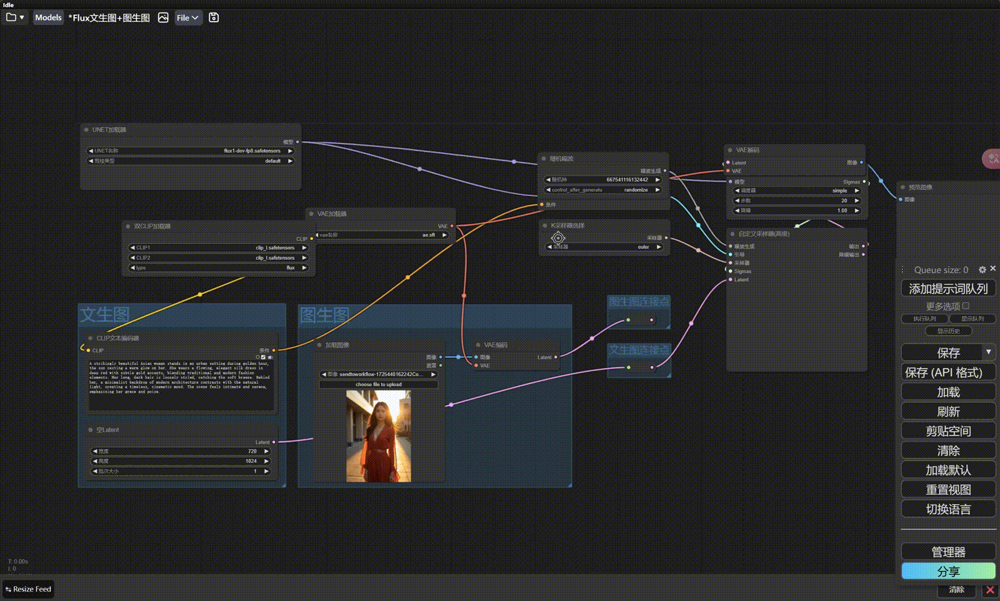

# ComfyUI-NodeAligner

ComfyUI-NodeAligner 是一个轻量级的 ComfyUI 布局插件，包含节点对齐、分布和调整大小等功能。该插件旨在简化可视化节点编辑器或自定义 UI 组件中的布局调整，使节点排列更加方便和高效。

ComfyUI-NodeAligner is a lightweight ComfyUI layout plugin that includes features such as node alignment, distribution, and resizing. This plugin is designed to simplify layout adjustments in visual node editors or custom UI components, making node arrangement more convenient and efficient.

## 功能 Features
- 节点左对齐、右对齐、顶部对齐、底部对齐  
  Align nodes to left, right, top, bottom.
- 水平和垂直居中对齐  
  Center nodes horizontally and vertically.
- 使选中的节点等宽等高  
  Equalize the width and height of selected nodes.
- 水平或垂直均匀分布节点  
  Distribute nodes evenly across horizontal or vertical space.

## 使用方法 Method of Application
1. 选中节点后使用工具栏进行对齐、分布或统一尺寸。单个节点对齐时保持当前位置。
   Select nodes and use the toolbar to align, distribute, or equalize their sizes. Aligning a single node preserves its position.

2. 按住 Shift 键或 Ctrl 键，点选多个节点，点击按钮，即可完成对齐和分布。  
   Hold the Shift or Ctrl key, select multiple nodes, and click the button to complete alignment and distribution.

3. 点击空白处取消选择。  
   Click on the blank space to deselect.

4. 未选中节点时，点击左对齐会恢复预设起始视图和 100% 缩放。
   With no nodes selected, left alignment restores the preset starting view at 100% zoom.

5. 点中对齐按钮中间的黑色分割线可实现组件的拖拽，进行移动。
   The black division line in the center of the right alignment button allows for component dragging and movement.
     

6. 右键点击本功能栏可选择模式，可选驻留或选中节点后显示。（选择点击>=2个时在鼠标旁显示此功能栏）
   Right-click on this toolbar to choose the mode, with options for either pinning it or showing it after selecting nodes. (When selecting two or more nodes, this toolbar will appear next to the mouse.)

   ps: 按住 Shift 进行拖拽可以对多个选择节点同时进行拖拽。
   ps: Hold Shift to drag and move multiple selected nodes.


视频演示：https://space.bilibili.com/15855661?spm_id_from=333.337.search-card.all.click



## 安装 Installation
1. 克隆仓库：  
   Clone the repository:
   ```bash
   git clone https://github.com/Tenney95/ComfyUI-NodeAligner.git
   ```
2. 将 `ComfyUI-NodeAligner` 文件夹复制到 `ComfyUI/custom_nodes` 目录下。  

## 1.0.1 兼容更新 Compatibility update

- 接入 ComfyUI 扩展生命周期，优先使用 `selectedItems`，保留旧前端选区兼容。
- 对齐、分布和尺寸修改接入撤销/重做；调整尺寸调用节点的 `setSize`，同步控件布局。
- 修复重复拖动监听、普通点击覆盖驻留位置、临时浮栏定位和监听清理。
- 保留原有分组、分布和尺寸取整规则，按钮增加中文提示。

Uses ComfyUI extension setup and modern selection APIs, records undoable edits, updates widget layouts through `setSize`, and fixes toolbar dragging and positioning while preserving existing layout rules.

2026-11-05 验证：本机前端 **1.57.6** 的传统节点和 **Nodes 2.0** 均已实测多选浮栏、顶部对齐、等宽及单次撤销；另已核对官方 [1.60.0](https://github.com/Comfy-Org/ComfyUI_frontend/releases/tag/v1.60.0) 的相关接口，尚未在该版本完整环境实测。

验证命令（仅需 Node.js，无额外依赖）：

```bash
node --check node_info.js
node tests/node_info.test.cjs
```

更新后先保存工作流，再刷新 ComfyUI 页面。
